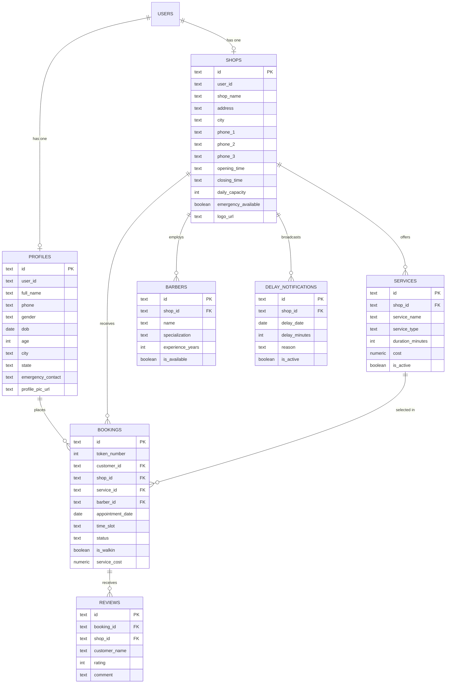

# Q-Through 💈

> **Appointment Scheduling & Live Queue Management System for Barbershops**

[](https://vercel.com/new)


---

## 📌 Overview

**Q-Through** is a dual-portal web application built to eliminate unmanaged customer queues and waiting room overcrowding in barbershops. It brings both **Customers** and **Barbershop Operators** into a single unified portal with role-based workflows:

- **Customer Portal:** Search local barbershops by name, city, or grooming service; compare transparent service durations and INR pricing; pick an available barber and time slot protected against overbooking; receive a sequential digital queue token; track live queue status; reschedule or cancel bookings; leave post-service reviews; and see active shop delay alerts.
- **Shop Portal:** Operate a live queue command center with four daily KPI counters (`In Queue`, `In Progress`, `Done Today`, `Total Today`), transition tokens across their lifecycle (`Waiting` ➔ `In Progress` ➔ `Done` / `Cancelled`), add unscheduled walk-in clients in seconds, broadcast operational delay notices, manage the grooming service catalog (CRUD), and configure the barber team roster and shop profile.

The platform is engineered for **zero-cost cloud hosting** — deployed on **Vercel** with a **Supabase PostgreSQL** backend communicating strictly over **standard HTTP REST APIs** (`GET` / `POST` / `PATCH` / `DELETE`) with background polling and an automatic offline-resilient cache.

---

## 🏗️ System Architecture & Dual-Portal Flow

```text
                          ┌─────────────────────────────┐
                          │   Landing & Discovery Page  │
                          │ (Interactive Preview, FAQs) │
                          └──────────────┬──────────────┘
                                         │
                         ┌───────────────┴───────────────┐
                         ▼                               ▼
                 ┌───────────────┐               ┌───────────────┐
                 │  Login Portal │               │ Signup Portal │
                 │ (User / Shop) │               │ (User / Shop) │
                 └───────┬───────┘               └───────┬───────┘
                         │                               │
        ┌────────────────┴───────────────┬───────────────┴────────────────┐
        ▼                                                                 ▼
┌─────────────────────────────────┐                     ┌─────────────────────────────────┐
│     CUSTOMER PORTAL FLOW        │                     │       SHOP PORTAL FLOW          │
├─────────────────────────────────┤                     ├─────────────────────────────────┤
│ 1. Onboarding / Profile Setup   │                     │ 1. Onboarding / Profile Setup   │
│    - Name, Verified Email       │                     │    - Shop Name, Address, City   │
│    - 10-digit Mobile Validation │                     │    - 3 Phone Numbers (1, 2, 3)  │
│    - DOB (Auto-calculated Age)  │                     │    - Hours, Daily Capacity, Logo│
│    - Gender, Avatar, Location   │                     │    - Initial Services & Pricing │
│                                 │                     │                                 │
│ 2. Barbershop Discovery         │                     │ 2. Live Queue Command Center    │
│    - Search by Name / Locality  │                     │    - KPI Counters (Queue, Work, │
│    - Filter by Service Category │                     │      Done Today, Total Today)   │
│    - Timings & 24/7 Badges      │                     │    - Active Ordered Queue Table │
│                                 │                     │                                 │
│ 3. Interactive Booking Engine   │                     │ 3. Token Lifecycle Controls     │
│    - Service & Barber Selection │                     │    - Call Next  ➔ In Progress   │
│    - Date & Free/Full Slots     │                     │    - Complete   ➔ Done          │
│    - Autofill Confirm Popup     │                     │    - Skip/Remove➔ Cancelled     │
│    - Instant Sequential Token   │                     │                                 │
│                                 │                     │ 4. Walk-In & Delay Management   │
│ 4. 'My Bookings' Center         │                     │    - Instant Walk-In Modal      │
│    - Upcoming & Past Tabs       │                     │    - Broadcast Delay Alerts     │
│    - Reschedule / Cancel / Rate │                     │                                 │
│    - Live Delay Alert Banners   │                     │ 5. Services, Barbers & Profile  │
│                                 │                     │    - Full Services CRUD         │
│ 5. Editable Customer Profile    │                     │    - Barber Roster & Duty Toggle│
└─────────────────────────────────┘                     └─────────────────────────────────┘
```

---

## ✨ Key Features

### Customer Experience
- **Unified Auth & Onboarding:** Role-toggleable login/signup with password strength validation (8+ chars, uppercase, number, symbol), Indian 10-digit phone validation, and automatic age calculation derived from Date of Birth.
- **Discovery & Service Filtering:** Real-time text search across shop names, addresses, and cities combined with category filters (`Haircut`, `Beard Trim`, `Shave`, `Hair Colour`, `Kids Cut`, `Head Massage`, `Facial`).
- **Capacity-Aware Slot Picker:** Evaluates active bookings and barber availability to mark slots as `Free` or `Full`, preventing double-bookings.
- **Autofill Confirmation & Digital Token:** Pre-fills verified profile details for one-tap booking confirmation, generating a shop-specific sequential daily token (e.g., `#01`, `#02`).
- **Booking Management:** Tabbed `Upcoming Appointments` and `Past Service History` views with live status badges, in-place rescheduling, cancellation guards, 5-star review submission, and prominent shop delay banners.

### Barbershop Operator Experience
- **Live Queue Dashboard:** Real-time operational metrics (`In Queue`, `In Progress`, `Done Today`, `Total Today`) paired with a searchable, ordered live queue table.
- **One-Tap Token Transitions:** Move customers through `Waiting` ➔ `In Progress` (`Call Next`) ➔ `Done` (`Complete`), or remove no-shows (`Skip / Remove`) with confirmation prompts.
- **5-Second Walk-In Intake:** Register unscheduled walk-in clients with Name, Mobile, and Service without requiring them to create an account — automatically issuing the next sequential token.
- **Operational Delay Broadcaster:** Broadcast estimated delay minutes and a custom reason message directly to all affected customers' upcoming booking cards, with one-click resolution once back on schedule.
- **Catalog & Team Management:** Add, edit, and delete grooming services (name, category, duration, INR price), manage barber profiles and on-duty availability, and update shop contact/capacity settings.

---

## 💻 Tech Stack

| Layer | Technology | Purpose |
|---|---|---|
| **Frontend** | **React 18.3** + **TypeScript 5.7** | Modular component architecture with strict static typing across all entities and state transitions. |
| **Build Tool** | **Vite 6.1** | Fast ES-module dev server with instant HMR and optimized Rollup production builds. |
| **Styling** | **Tailwind CSS 3.4** + **PostCSS** | Responsive, mobile-first design system (320px to 1920px) with clean slate/brand palettes and subtle glassmorphism. |
| **Icons & Effects** | **Lucide React** + **Canvas Confetti** | Crisp vector iconography and booking confirmation feedback. |
| **Backend & Database** | **Supabase (PostgreSQL)** | Relational cloud storage (`profiles`, `shops`, `services`, `barbers`, `bookings`, `delay_notifications`, `reviews`) accessed via `@supabase/supabase-js`. |
| **Data Sync** | **Standard HTTP REST Polling** | Pure HTTP `GET` / `POST` / `PATCH` / `DELETE` requests with an 8-second polling interval (IEEE SRS `COM-3`) and resilient `localStorage` fallback — zero WebSocket overhead or paid tiers. |
| **Deployment** | **Vercel** | Edge-hosted SPA with `vercel.json` rewrite rules for seamless client-side routing. |

---

## 📁 Project Structure

```text
Q-through/
├── index.html                           # Application entry HTML & fonts
├── package.json                         # Dependencies and build scripts
├── vercel.json                          # Vercel SPA routing & build configuration
├── vite.config.ts                       # Vite bundler & dev server config (port 5173)
├── tailwind.config.js                   # Tailwind theme palette & typography
├── tsconfig.json                        # Strict TypeScript compiler config
├── supabase_schema.sql                  # Ready-to-run PostgreSQL table schema & RLS policies
├── .env.example                         # Environment variable template
└── src/
    ├── main.tsx                         # React root mounting
    ├── App.tsx                          # Role-based view router
    ├── index.css                        # Global Tailwind styles & utility animations
    ├── types/
    │   └── index.ts                     # Shared TypeScript interfaces (SRS entities)
    ├── lib/
    │   └── supabaseClient.ts            # Supabase HTTP REST client (WebSockets disabled)
    ├── data/
    │   └── mockData.ts                  # Initial seed data for barbershops, services & barbers
    ├── context/
    │   └── AppContext.tsx               # Centralized state, REST polling & CRUD mutations
    └── components/
        ├── common/                      # Navbar, Footer, Modal, Status Badges
        ├── landing/                     # Interactive hero preview, workflow, partners & FAQs
        ├── auth/                        # Unified Login/Signup modal with role selector
        ├── onboarding/                  # Customer & Shop initial profile setup wizards
        ├── customer/                    # Shop discovery, booking flow, My Bookings & profile
        └── shop/                        # Live queue desk, walk-in, delay broadcast, services & barbers
```

---

## 🗄️ Database Schema



---

## 📋 Requirements Traceability (IEEE SRS v1.0)

| Module | Requirement ID | Summary | Status |
|---|---|---|---|
| **Authentication & RBAC** | `FR-1` – `FR-5` | Role-based registration/login (`Customer` / `Shop`), password policy enforcement, isolated portal access, session signout. | ✅ Implemented |
| **Customer Profile Setup** | `FR-6` – `FR-9` | Profile onboarding wizard, auto-calculated age from DOB, phone format validation, editable profile settings. | ✅ Implemented |
| **Barbershop Search & Filter** | `FR-10` – `FR-13` | Search by shop name/city/locality, service-type filter pills, shop overview cards, empty-state handling. | ✅ Implemented |
| **Appointment Booking** | `FR-14` – `FR-21` | Service/barber selection, dynamic Free/Full time slots, double-booking guard, sequential daily token generation. | ✅ Implemented |
| **My Bookings & Alerts** | `FR-22` – `FR-25` | Upcoming & Past tabs, <10s status sync via REST polling, reschedule/cancel flows, active delay banners. | ✅ Implemented |
| **Shop Profile Setup** | `FR-26` – `FR-29` | Multi-phone registration, operating hours, daily capacity configuration, logo branding, live edits. | ✅ Implemented |
| **Barber Management** | `FR-30` – `FR-33` | Barber roster creation, specializations, experience tracking, and live on-duty/off-duty availability toggling. | ✅ Implemented |
| **Live Queue Dashboard** | `FR-34` – `FR-36` | Four daily KPI counters (`In Queue`, `In Progress`, `Done Today`, `Total Today`) and ordered live queue table. | ✅ Implemented |
| **Token Lifecycle** | `FR-37` – `FR-42` | One-tap transitions (`Waiting` ➔ `In Progress` ➔ `Done`), confirmation guard on cancellations. | ✅ Implemented |
| **Walk-In Management** | `FR-43` – `FR-46` | Prominent walk-in modal generating sequential tokens directly into the live queue. | ✅ Implemented |
| **Delay Broadcasts** | `FR-47` – `FR-49` | Always-accessible delay broadcaster syncing delay minutes and reasons to affected customer cards. | ✅ Implemented |
| **Service Catalog CRUD** | `FR-50` – `FR-53` | Add, edit, and delete grooming services with immediate updates in the customer booking flow. | ✅ Implemented |

---

## 🚀 Getting Started

### Prerequisites
- **Node.js** `18.17+` (verified on `v24.x`)
- **npm** `9+`

### 1. Clone the Repository
```bash
git clone https://github.com/<your-username>/q-through.git
cd q-through
```

### 2. Install Dependencies
```bash
npm install
```

### 3. Configure Environment Variables
Copy `.env.example` to `.env.local` and fill in your Supabase credentials:
```env
VITE_SUPABASE_URL=https://your-project-id.supabase.co
VITE_SUPABASE_ANON_KEY=your-supabase-anon-key
```

### 4. Initialize the Supabase Database *(Optional)*
1. Open your [Supabase Dashboard](https://supabase.com/dashboard) and navigate to the **SQL Editor**.
2. Paste the contents of [`supabase_schema.sql`](supabase_schema.sql) and click **Run**.
3. This creates all PostgreSQL tables and Row-Level Security policies.

> **Note:** The application includes a pre-seeded offline-first storage adapter so all customer and shop workflows operate smoothly out of the box even before connecting a cloud database.

### 5. Run the Development Server
```bash
npm run dev
```
Open [http://localhost:5173](http://localhost:5173) in your browser.

### 6. Build for Production
```bash
npm run build
npm run preview
```

---

## 🌐 Deploying to Vercel

1. Push the repository to GitHub.
2. Open the [Vercel Dashboard](https://vercel.com/new) and import your repository.
3. Vercel automatically detects **Vite**:
   - **Build Command:** `npm run build`
   - **Output Directory:** `dist`
4. Add `VITE_SUPABASE_URL` and `VITE_SUPABASE_ANON_KEY` under **Environment Variables**.
5. Click **Deploy**. SPA routing is pre-configured via [`vercel.json`](vercel.json).

---

## ⚡ Key Engineering Highlights

- **Dual-Portal RBAC Architecture:** Single React + TypeScript codebase serving distinct customer and operator workflows with role-isolated navigation and state.
- **Sequential Token State Machine:** Atomic daily per-shop token generation with deterministic transitions (`Waiting` ➔ `In Progress` ➔ `Done` / `Cancelled`) across both online bookings and walk-in clients.
- **Zero-Cost Cloud Synchronization:** Pure HTTP REST polling (`8s` interval) against Supabase PostgreSQL paired with optimistic UI updates and local storage fallback — keeping cloud infrastructure completely free.
- **Capacity-Aware Scheduling:** Real-time slot computation factoring shop operating hours, barber counts, and existing confirmed bookings to prevent overbooking.

---

## 📄 License

This project is licensed under the **MIT License**.
